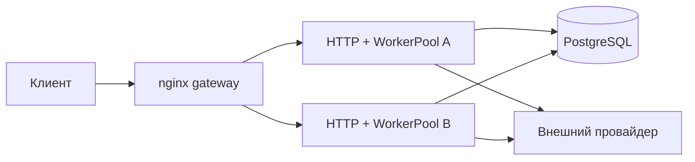
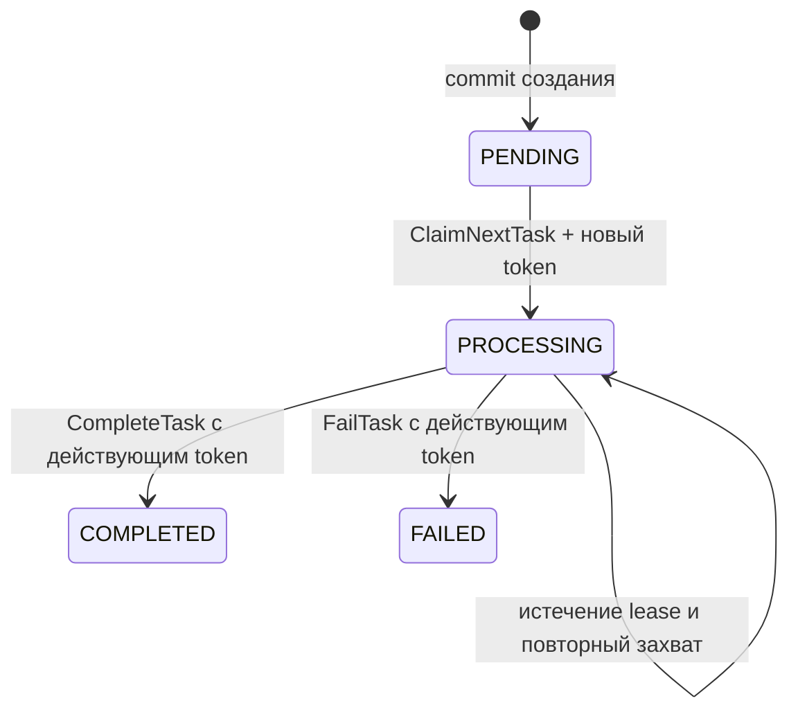

# Документация кода Exchange Rate Service

## Архитектура и границы ответственности

Сервис допускает несколько независимых процессов с одной PostgreSQL. Каждый
процесс обслуживает HTTP и запускает свой `WorkerPool`. В памяти процесса нет
очереди задач, списка владельцев, истории разрешений или общей паузы провайдера.
Источником этих данных служит БД. PostgreSQL должен быть доступен для записи;
реплика только для чтения не подходит для захвата задач и выдачи разрешений.

| Пакет | Ответственность |
| --- | --- |
| `cmd/exchange-rate-service` | Сборка зависимостей, HTTP, сигналы, общий срок остановки |
| `internal/config` | Чтение и проверка окружения |
| `internal/httpapi` | Проверка JSON, UUID и ключа, отображение ошибок в HTTP |
| `internal/service` | Прикладные операции, цикл воркера, heartbeat, ожидание квоты и повторы |
| `internal/postgres` | Транзакции очереди, идемпотентность, lease/fencing, квоты |
| `internal/provider/exchangeratedev` | HTTP-клиент провайдера и разбор `Retry-After` |
| `internal/models` | Валютные пары, котировки, задачи и статусы |
| `internal/apperrors` | Общие типизированные ошибки |

`service` зависит от интерфейсов `TaskRepository`, `RateProvider`, `PermitStore`,
но не от PostgreSQL или HTTP-клиента. Реализации соединяет `runApplication`.



## Создание и чтение задач

`ApplicationService.CreateUpdateWithKey` нормализует пару через
`models.NewCurrencyPair` и вызывает `Create` либо `CreateOrGet`. Оба пути
сохранения используют одну транзакцию:

1. `SELECT ... FOR UPDATE` блокирует единственную строку `task_queue_guard`.
2. Для ключа ищется существующая задача. Та же пара возвращает прежний UUID,
   другая — `ErrIdempotencyConflict`. Проверка выполняется до лимита очереди.
3. Подсчитываются `PENDING` + `PROCESSING`. При достижении `QUEUE_SIZE` возвращается
   `ErrQueueFull`; новая строка не появляется.
4. Создаётся `PENDING` и фиксируется транзакция. Уникальный индекс
   `idempotency_key` и `ON CONFLICT` остаются дополнительной защитой.

`READ COMMITTED` обеспечивает новый snapshot после ожидания блокировки.
Состояния `PROCESSING` с истёкшей арендой продолжают занимать очередь. Завершение
или ошибка освобождают ёмкость. Все писатели должны соблюдать этот протокол.

После commit приложение вызывает `Notify()`. Канал содержит только сигналы
пробуждения; потеря сигнала или остановка создавшего задачу процесса не влияет
на доставку. Отмена HTTP после commit не удаляет задачу. Повтор с тем же ключом
позволяет получить UUID, если клиент не получил первый ответ.

`GetUpdate` читает задачу по UUID. `GetLatestQuote` выбирает только `COMPLETED`,
сортируя по `updated_at DESC, id DESC`. Чтения не вызывают провайдера и не меняют
времена. `updated_at` — время получения курса сервисом, а не публикации у
провайдера. Время результата сохраняется в UTC.

## WorkerPool и lease/fencing

`Start` запускает `WORKER_COUNT` горутин. Каждая сразу вызывает `ClaimNextTask`,
после выполнения снова опрашивает БД, а при отсутствии работы/ошибке ожидает
`WORKER_POLL_INTERVAL` либо `Notify`. Пул запускается один раз.

`ClaimNextTask` атомарно выбирает старейшую доступную задачу через
`FOR UPDATE SKIP LOCKED` и устанавливает новый UUID-токен, `PROCESSING` и
`leased_until = clock_timestamp() + TASK_LEASE_DURATION`. Доступны `PENDING`
и `PROCESSING` с истёкшим lease. Порядок — `created_at, id`; строгая FIFO при
конкуренции и блокировках не гарантируется. Соединение после захвата освобождается.



`processLeasedTask` запускает heartbeat каждые `lease/3`. `RenewLease` проверяет
статус, токен и неистёкший lease. Ошибка, таймаут или отказ продления отменяют
контекст задачи, HTTP-запрос и ожидание квоты. Heartbeat действует также во время
ожидания квоты и повторов; он завершается вместе с задачей.

`CompleteTask` и `FailTask` обновляют только строку с тем же токеном и
`leased_until > clock_timestamp()`. При успешной финализации lease-поля
очищаются. Устаревший воркер не может записать результат даже после возобновления
процесса. Ошибка записи оставляет задачу доступной для будущего захвата после
истечения lease. Нет общего сброса `PROCESSING` при запуске.

Гарантия — повторяемая обработка, а не exactly-once вызов провайдера: при сбое,
сетевой задержке или паузе процесса два внешних запроса могут пересечься во
времени, но записать результат может только действующий владелец. Квота
расходуется и на повторные запросы. Остановка процесса не требует локальной
recovery-очереди или session advisory lock.

## Распределённый RateLimiter

`service.RateLimiter.Wait` вызывает `PermitStore.AcquirePermit`. Нулевая задержка
означает зафиксированное разрешение; положительная — необходимость подождать
вне транзакции и снова проверить БД. Контекст прерывает ожидание.

`postgres.RateLimiterStore.AcquirePermit`:

1. Блокирует строку `provider_rate_limit` через `SELECT ... FOR UPDATE`.
2. Читает `clock_timestamp()` после захвата блокировки.
3. Удаляет попытки с временем `<= now - 1 hour`.
4. Находит ближайшее разрешённое время по обеим квотам и `blocked_until`.
   Используется N-я самая новая попытка плюс длительность соответствующего окна.
5. Если ждать не нужно, вставляет попытку в `provider_attempts` и делает commit.
   Иначе возвращает задержку после завершения транзакции.

Окна точные: `(now - 1 minute, now]` и `(now - 1 hour, now]`. История и пауза
сохраняются при перезапуске всех процессов. `PauseUntil` атомарно сохраняет
`GREATEST(blocked_until, until)` в той же служебной строке. Более старый ответ
не может сократить паузу. Уже выданные разрешения не отзываются.

`getRate` получает разрешение перед каждой попыткой, затем создаёт отдельный
таймаут HTTP. Повторяются только `ErrProviderRateLimited`: используется
`Retry-After` (секунды или HTTP-date), иначе задержка с удвоением и защитой от
переполнения. Пауза сохраняется даже после последней попытки. Ошибка получения
разрешения запрещает вызов провайдера; ошибка сохранения паузы прекращает
повторы. Если запись состояния задачи доступна, такая ошибка завершает задачу
как `FAILED`; иначе задачу повторно захватят после lease.

Подсчёт квот и lease используют часы БД. Абсолютный `Retry-After` и fallback
формируются адаптером/сервисом с часами процесса: часы узлов должны быть
синхронизированы. Один набор таблиц соответствует одному общему бюджету
провайдера. Для нескольких независимых провайдеров/аккаунтов потребовалось бы
разделение ключа бюджета; сейчас оно не реализовано.

## Остановка процесса

`runApplication` завершает HTTP через `Shutdown`, затем вызывает `WorkerPool.Stop`
с оставшимся общим сроком. HTTP-обработчики успевают завершить сохранение.
`Stop` отменяет контекст захвата, не начинает новые задачи и ждёт текущие.
При истечении срока отменяется контекст работы, включая heartbeat и limiter.
После выхода горутин закрывается пул PostgreSQL. Незавершённые задачи остаются
в БД. Гонка остановки с commit захвата может оставить выданный lease до истечения.

`withShutdownDeadline` ограничивает также отложенную очистку: при зависании
процесс завершается с кодом 1. Параллельные `Stop` безопасны; повторный `Start`
запрещён. Зависимости обязаны уважать контекст. Docker ждёт 45 с при сроке
приложения 30 с.

## Конфигурация

| Переменная | Значение / проверка | Область |
| --- | --- | --- |
| `DATABASE_URL` | Обязательна | Общая БД |
| `SUPPORTED_CURRENCIES` | Обязательные трёхбуквенные коды | Одинаково на экземплярах |
| `WORKER_COUNT` | Обязательное положительное число | На экземпляр |
| `QUEUE_SIZE` | Обязательное положительное число | Все незавершённые задачи в БД |
| `TASK_LEASE_DURATION` | `30s`, минимум `1s` | Lease, heartbeat каждые lease/3 |
| `WORKER_POLL_INTERVAL` | `100ms`, минимум `1ms` | Опрос пустой очереди и после ошибки |
| `RATE_LIMIT_PER_MINUTE` / `RATE_LIMIT_PER_HOUR` | `10` / `100`, > 0 | Общие скользящие квоты |
| `RATE_LIMIT_MAX_RETRIES` | `2`, >= 0 | Дополнительные попытки после первой |
| `RATE_LIMIT_RETRY_DELAY` | `60s`, > 0 | Начальный fallback для 429 |
| `RATE_PROVIDER_URL` | Обязательный HTTP(S) URL | Один провайдер |
| `RATE_PROVIDER_TIMEOUT` | `10s`, > 0 | На каждую попытку |
| `RATE_PROVIDER_API_KEY` | Необязателен | Bearer авторизация |
| `HTTP_ADDRESS` | `:8080` | Адрес процесса |
| `SHUTDOWN_TIMEOUT` | `30s`, положительное; значения < 15s повышаются до 15s | Весь shutdown |
| `API_PORT` | Compose: `8080` | Порт gateway на loopback хоста |
| `APP_IMAGE` | Обязателен только в Hub override | Совместимый опубликованный образ |

`QUEUE_SIZE`, квоты, список валют и конфигурация провайдера должны совпадать у
всех экземпляров. Слишком короткий lease повышает вероятность повторных вызовов
при задержках БД/планировщика. Polling влияет на задержку получения работы и
нагрузку на БД, но не на корректность доставки.

## Таблицы, миграции и эксплуатационные допущения

- `000001`–`000003`: задачи, статусы и уникальный ключ идемпотентности.
- `000004`: lease-поля, ограничение согласованности, индекс истёкших аренд.
  Переход старых `PROCESSING` в `PENDING` требует остановки старых воркеров.
- `000005`: строка глобального допуска очереди и индекс незавершённых задач.
- `000006`: строка общей паузы и индексированная история разрешений.

Миграции выполняются отдельным процессом до запуска приложения. Смешанный
запуск старой и новой архитектуры не поддерживается. Lease и квоты рассчитаны
на обычное течение времени PostgreSQL; значительные скачки часов БД требуют
эксплуатационного вмешательства. Завершённые задачи и ключи не удаляются
автоматически; срока действия идемпотентности нет. Прямые SQL-вставки в очередь
могут обойти глобальный лимит и не являются поддерживаемым API.

## HTTP и OpenAPI

`docs/openapi.yaml` сохранён без изменения контракта. Внутренние lease-поля и
таблицы limiter не попадают в ответы.

| Операция | Ответы |
| --- | --- |
| `POST /rates/updates` | 202 `{id}`, 400, 409, 503 при полной очереди, 500 |
| `GET /rates/updates/{id}` | 200 `{rate,updated_at}`, 202 в работе, 502 при FAILED, 400, 404, 500 |
| `GET /rates/latest/{base}/{quote}` | 200 `{rate,updated_at}`, 400, 404, 500 |

Ошибки имеют форму `{error}`. `Idempotency-Key` необязателен; пустой,
пробельный, несколько значений, запятая и длина > 255 байт отвергаются.
Содержимое валидного ключа сохраняется без нормализации. HTTP-адаптер ограничивает
тело и проверяет структуру JSON, клиент провайдера ограничивает ответ 1 MiB и
проверяет положительный конечный курс, пару и формат результата.

## Проверки

| Набор | Что проверяет |
| --- | --- |
| `internal/service/*_test.go` | Создание/Notify, идемпотентность, остановка захвата, отмена, heartbeat, повторы и квота |
| `internal/config/config_test.go` | Значения по умолчанию и ошибки окружения, в том числе lease/polling |
| `internal/httpapi/*_test.go` | Контракт, валидация, история котировок, коды ошибок |
| `internal/provider/exchangeratedev/*_test.go` | HTTP-клиент, ошибки, Retry-After, таймауты |
| `cmd/exchange-rate-service/*_test.go` | HTTP shutdown и watchdog в дочерних процессах |

Тесты не создают базы данных или схемы и не требуют PostgreSQL.
Новые проверки бизнес-логики выполняются unit-тестами с заглушками интерфейсов в памяти.

```bash
go test ./...
go test -race ./...
```

Реальный exchangerate.dev в тестах не вызывается.
