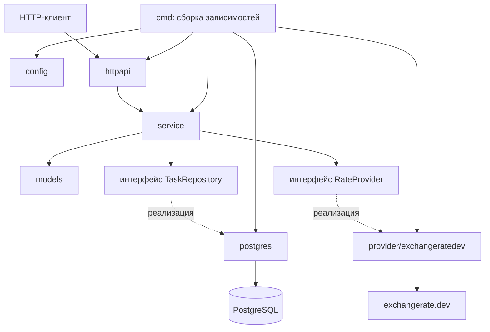
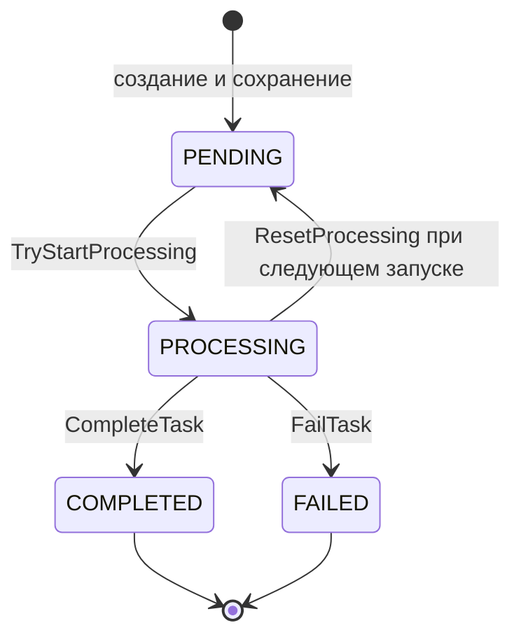

# Документация кода Exchange Rate Service

Документ описывает текущую реализацию проекта: архитектуру, ответственность слоев и все 48 Go-файлов, включая тесты. Пути указаны относительно корня репозитория. Для каждого файла перечислены объявленные в нем функции и методы; методы интерфейсов описаны как контракты. Анонимные функции внутри методов рассматриваются как часть их реализации.

## 1. Назначение и архитектура

Exchange Rate Service — HTTP-сервис для асинхронного получения валютных котировок из exchangerate.dev. Клиент создает задачу, получает UUID и позднее запрашивает результат. Отдельный маршрут возвращает последнюю успешную котировку валютной пары. Список поддерживаемых валют передается через конфигурацию; сами модели не содержат жестко заданного набора USD, EUR и MXN.

Архитектура слоистая, с отделением прикладной логики от HTTP, PostgreSQL и внешнего API. Зависимости собираются вручную в точке входа и передаются через конструкторы. Интерфейсы `TaskRepository` и `RateProvider` позволяют тестировать прикладной слой с подменными реализациями.

### 1.1. Ответственность слоев

| Каталог | Слой | Ответственность |
| --- | --- | --- |
| `cmd/exchange-rate-service` | Запуск и управление процессом | Загрузка конфигурации, создание зависимостей, запуск HTTP и фоновой обработки, обработка сигналов, завершение работы. |
| `internal/config` | Конфигурация | Чтение переменных окружения, значения по умолчанию, проверка параметров запуска. |
| `internal/httpapi` | Входной HTTP-адаптер | Маршрутизация, проверка JSON, UUID и заголовков, вызов прикладных операций, формирование безопасных ответов. |
| `internal/service` | Прикладной слой | Создание и чтение задач, резервирование очереди, фоновая обработка, восстановление, ограничение частоты запросов и повторные попытки. |
| `internal/models` | Модель предметной области | Валютная пара и ее правила проверки, котировка, задача и состояния задачи. |
| `internal/postgres` | Адаптер хранения | SQL-запросы, хранение задач и котировок, идемпотентность, условные смены статусов, исключительное владение обработкой задач. |
| `internal/provider/exchangeratedev` | Адаптер внешнего API | Получение курса по HTTP, проверка ответа, нормализация ошибок, разбор `Retry-After`. |
| `internal/apperrors` | Общий словарь ошибок | Ошибки, распознаваемые между слоями через `errors.Is` и `errors.As`. |

Пакеты `httpapi` и `service` не выполняют SQL-запросы. Прикладной слой не импортирует конкретные адаптеры PostgreSQL и exchangerate.dev. Модели зависят от общих ошибок, но не от конфигурации или инфраструктуры. Конкретные реализации соединяет `main.go`.



### 1.2. Создание и обработка задачи

1. `POST /rates/updates` принимает JSON с полями `base` и `quote` и необязательный `Idempotency-Key`.
2. HTTP-обработчик проверяет структуру запроса. `ApplicationService` нормализует и проверяет валютную пару через `models.NewCurrencyPair`.
3. Для новой задачи создаются UUID v4, статус `PENDING` и время `CreatedAt` в UTC. До записи в БД резервируется место в очереди, а UUID регистрируется среди активных задач. При отсутствии места возвращается ошибка перегрузки без создания новой строки.
4. Репозиторий сохраняет задачу. При наличии ключа `CreateOrGet` сначала проверяет существующую запись: одинаковая нормализованная пара возвращает прежний UUID, другая пара вызывает конфликт.
5. После успешной записи новая задача помещается в канал `jobs`. Зарезервированное место гарантирует постановку даже при отмене HTTP-запроса после сохранения. Клиент получает `202` с UUID.
6. Воркер извлекает задачу и освобождает место очереди. Выполняемые задачи не занимают ее емкость. Условное SQL-обновление `PENDING → PROCESSING` разрешает работу только тому вызову, который действительно изменил строку.
7. Воркер ожидает общую квоту, вызывает провайдера и при необходимости повторяет запрос после ограничения частоты. Успех сохраняется как `COMPLETED`, ошибка провайдера — как `FAILED` с безопасным сообщением.



`UpdatedAt` — время успешного получения курса самим сервисом, а не время публикации курса провайдером. `CompletedAt` — время завершения задачи. Чтение возвращает сохраненные отметки времени и не обновляет их.

### 1.3. Чтение результатов и HTTP-ответы

| Операция | Поведение |
| --- | --- |
| `POST /rates/updates` | `202` с UUID для новой или ранее созданной задачи; `400` при неверном запросе; `409` при конфликте ключа; `503` при перегрузке; `500` при прочей внутренней ошибке. |
| `GET /rates/updates/{id}` | `202` для `PENDING`/`PROCESSING`; `200` с `rate` и `updated_at` для `COMPLETED`; `502` для `FAILED`; `400` при неверном UUID; `404` при отсутствии задачи; `500` при внутренней ошибке или несогласованных данных. |
| `GET /rates/latest/{base}/{quote}` | `200` с последней успешной котировкой; `400` при неверной или неподдерживаемой паре; `404`, если успешных котировок нет; `500` при внутренней ошибке. |

Последняя котировка выбирается только из `COMPLETED`, по `updated_at DESC, id DESC`. Более новая неуспешная или незавершенная задача не заменяет успешный результат. Перечень выше описывает обработчики; стандартный `http.ServeMux` также обрабатывает неизвестные пути и неподходящие HTTP-методы.

### 1.4. Хранение, идемпотентность и восстановление

Задачи и результаты находятся в одной таблице `update_tasks`. Отдельной таблицы последних курсов нет. SQL-миграции создают таблицу и индексы, приводят статус `IN_PROGRESS` к используемому в Go `PROCESSING` и добавляют уникальный `idempotency_key`.

Ключ идемпотентности сохраняется в БД. Повторный запрос не меняет существующую задачу, не ставит ее в очередь повторно и не требует свободного места. Это относится ко всем ее статусам, включая `FAILED`. Без ключа каждый запрос создает отдельную задачу. Ключ сохраняется без нормализации: пробелы по краям непустого значения значимы. Срок действия или удаление ключей в текущем коде не предусмотрены.

Сервис рассчитан на один активный экземпляр на базу данных. Перед запуском воркеров репозиторий открывает отдельное физическое соединение и получает PostgreSQL session advisory lock. Все изменения задач выполняются через это соединение последовательно. Потеря соединения запрещает дальнейшие записи старого экземпляра; автоматического переподключения этой сессии нет. Обычные чтения по UUID и последней котировке используют пул соединений.

После получения владения `ResetProcessing` один раз переводит оставшиеся `PROCESSING` в `PENDING`. Затем фоновое восстановление опрашивает БД с интервалом 100 мс и забирает ожидающие задачи порциями по свободной емкости очереди. `active` исключает уже принятые UUID, а `scanSeen` защищает от устаревших результатов выборки, если задача была создана и обработана во время запроса восстановления.

Если сохранение результата завершилось ошибкой, воркер не повторяет запрос к провайдеру сразу: задача остается `PROCESSING` до восстановления при следующем запуске. Поэтому система не гарантирует единственный внешний запрос на задачу при сбое процесса между получением курса и записью результата.

### 1.5. Ограничения запросов и завершение работы

Все воркеры разделяют один `RateLimiter`: он учитывает попытки в скользящих окнах длительностью минуту и час и общую паузу после ограничения провайдера. Каждая разрешенная попытка, включая повторную, расходует квоту. Счетчики находятся в памяти и сбрасываются при перезапуске.

Повторяются только ошибки `ErrProviderRateLimited`. Используется время из `Retry-After`, а при его отсутствии — настраиваемая задержка с удвоением. Общая пауза устанавливается даже после исчерпания попыток конкретной задачи. Тайм-аут вызова провайдера начинается после ожидания квоты и применяется к каждой попытке отдельно.

При штатной остановке сначала прекращается прием HTTP-запросов и ожидается завершение активных обработчиков. Затем пул запрещает новые задания, останавливает восстановление, дожидается производителей очереди, закрывает канал и дорабатывает принятые задачи. По истечении срока отменяются фоновые операции; незавершенные задачи остаются доступными для восстановления. После выхода воркеров закрываются сессия владения и пул БД. Отдельный таймер завершает весь процесс с кодом `1`, если остановка вместе с отложенной очисткой превышает общий срок.

## 2. Файлы запуска приложения

### `cmd/exchange-rate-service/main.go`

Точка сборки зависимостей и управления жизненным циклом.

| Функция | Назначение |
| --- | --- |
| `main()` | Вызывает `run`; при ошибке пишет ее в журнал и завершает процесс с кодом `1`. |
| `run()` | Загружает `Config` и выполняет приложение внутри `withShutdownDeadline`. |
| `runApplication(cfg, startShutdown)` | Настраивает SIGINT/SIGTERM и десятисекундный контекст запуска; создает и проверяет пул БД; получает владение; создает провайдера, ограничитель и воркеры; сбрасывает незавершенные задачи; запускает воркеры, восстановление и HTTP. Ожидает сигнал, ошибку сервера или потерю владения, затем организует остановку и очистку. |
| `shutdownHTTPServer(ctx, server)` | Вызывает мягкую остановку `Shutdown`; при ошибке принудительно закрывает сервер через `Close` и объединяет ошибки. |

HTTP-тайм-ауты: заголовки — 5 с, чтение — 10 с, запись — 15 с, простой соединения — 60 с. Контекст воркеров независим от контекстов HTTP-запросов и от сигнала начала штатной остановки.

### `cmd/exchange-rate-service/shutdown.go`

Ограничивает общую длительность остановки процесса.

- `withShutdownDeadline(timeout, run)` — передает исполняемой функции callback `startShutdown`. Первый вызов callback запускает watchdog; повторные вызовы не продлевают срок. Таймер остается активным во время `defer`-очистки приложения и вызывает `os.Exit(1)` при превышении срока. После нормального возврата таймер останавливается.

### `cmd/exchange-rate-service/main_test.go`

Проверяет остановку HTTP-сервера.

- `TestShutdownHTTPServer` — проверяет ожидание активного запроса при мягкой остановке, принудительное закрытие при истекшем сроке и прекращение приема новых запросов.

### `cmd/exchange-rate-service/shutdown_test.go`

Проверяет watchdog в дочернем процессе, чтобы вызов `os.Exit` не завершил основной запуск тестов.

- `TestShutdownDeadline` — запускает дочерние сценарии нормального завершения, зависания, зависшей отложенной очистки, ошибки запуска, выключения таймера, обычной работы до остановки и повторного запуска отсчета; проверяет код выхода и диагностику.
- `TestShutdownDeadlineProcess` — исполняет выбранный через `SHUTDOWN_WATCHDOG_TEST` сценарий с виртуальным временем `testing/synctest`; без переменной сразу возвращается.

## 3. Модели предметной области

### `internal/models/currency_pair.go`

Содержит `CurrencyPair` с полями `BaseCurrency` и `QuoteCurrency` и правила допустимости пары.

- `NewCurrencyPair(base, quote, supportedCurrencies)` — нормализует оба кода, создает пару и вызывает `Validate`; при ошибке возвращает пустую пару.
- `CurrencyPair.Validate(supportedCurrencies)` — требует непустые трехбуквенные коды из `A–Z`, разные валюты и присутствие обеих в переданном наборе. Не изменяет и не нормализует структуру. Пустой или `nil`-набор не допускает ни одну пару.
- `normalize(code)` — удаляет окружающие пробелы и переводит строку в верхний регистр.
- `containsOnlyLatinLetters(code)` — проверяет каждый символ на принадлежность диапазону `A–Z`.

### `internal/models/quote.go`

Объявляет `Quote`: валютная пара `Pair`, курс `Rate` типа `float64` и время получения `UpdatedAt`. Функций и методов нет.

### `internal/models/update_task.go`

Объявляет строковый тип `UpdateStatus`, константы `StatusPending`, `StatusProcessing`, `StatusCompleted`, `StatusFailed` и структуру `UpdateTask`. Задача содержит UUID, пару, статус, необязательную котировку, сообщение об ошибке, время создания и необязательное время завершения. Функций и методов нет.

### `internal/models/currency_pair_test.go`

Проверяет правила валютной пары независимо от конфигурации и инфраструктуры.

- `TestNewCurrencyPair` — проверяет нормализацию регистра и пробелов, допустимые пары, неверную длину и символы, одинаковые и неподдерживаемые валюты.
- `TestCurrencyPairValidate` — проверяет ограничения для каждого поля напрямую, в том числе пустой код; подтверждает отсутствие нормализации и изменения структуры.
- `TestCurrencyPairSupportedCurrencies` — проверяет влияние изменения переданного набора, отсутствие одной или обеих валют, пустой и `nil`-набор для конструктора и `Validate`.

## 4. Общие ошибки

### `internal/apperrors/errors.go`

Объявляет значения ошибок приложения: конфликт идемпотентности, неверная пара, неподдерживаемая валюта, перегрузка, отсутствие задачи или котировки. Также содержит ошибки провайдера: авторизация, запрет доступа, квота, тайм-аут, недоступность, неверный ответ, отсутствие котировки и неподдерживаемая пара. `ErrQueueFull` ссылается на `ErrServiceOverloaded`, поэтому обе проверки через `errors.Is` совместимы. Функций и методов нет.

### `internal/apperrors/rate_limit.go`

Объявляет `ProviderRateLimitError` с полем `RetryAt`. Нулевое время означает необходимость использовать настроенную задержку.

- `(*ProviderRateLimitError).Error()` — возвращает безопасное стандартное сообщение `ErrProviderRateLimited`.
- `(*ProviderRateLimitError).Unwrap()` — возвращает `ErrProviderRateLimited`, сохраняя совместимость с `errors.Is`; сам тип и время доступны через `errors.As`.

## 5. Конфигурация

### `internal/config/config.go`

Объявляет `Config` и загружает настройки из окружения. Самостоятельного чтения `.env` в Go-коде нет: переменные передаются процессу извне.

- `Load()` — читает, нормализует и проверяет настройки; возвращает целую конфигурацию либо ошибку. Требует `SUPPORTED_CURRENCIES`, `RATE_PROVIDER_URL`, `DATABASE_URL`, положительные `WORKER_COUNT` и `QUEUE_SIZE`. Для `DATABASE_URL` проверяет непустое значение, а подключение проверяется при запуске. API-ключ необязателен.
- `validHostname(host)` — допускает IP-адреса и синтаксически корректные DNS-имена, проверяет длины имени и частей, символы и дефисы; DNS-запросы не выполняет.
- `validCurrencyCode(code)` — проверяет три символа `A–Z` для уже нормализованного кода.
- `optionalInt(name, fallback, minimum)` — читает необязательное целое число; использует значение по умолчанию только при отсутствии переменной и проверяет нижнюю границу.

| Настройка | Значение по умолчанию и ограничения |
| --- | --- |
| `HTTP_ADDRESS` | `:8080`; адрес `host:port`, числовой порт 0–65535. |
| `RATE_PROVIDER_TIMEOUT` | `10s`; положительная длительность. |
| `SHUTDOWN_TIMEOUT` | `30s`; положительное заданное значение меньше `15s` повышается до `15s`. |
| `RATE_LIMIT_PER_MINUTE` | 10; не меньше 1. |
| `RATE_LIMIT_PER_HOUR` | 100; не меньше 1. |
| `RATE_LIMIT_MAX_RETRIES` | 2; не меньше 0, это число повторов после первой попытки. |
| `RATE_LIMIT_RETRY_DELAY` | `1m`; положительная длительность. |

### `internal/config/config_test.go`

Проверяет чтение окружения и валидацию конфигурации.

- `setValidEnvironment` — устанавливает базовое корректное тестовое окружение с автоматическим восстановлением через `t.Setenv`.
- `TestLoad` — проверяет разбор, нормализацию, удаление дубликатов и проверку списка валют.
- `TestLoadMissingSupportedCurrencies` — проверяет отказ при отсутствующей переменной списка валют.
- `TestLoadDatabaseConfiguration` — проверяет обязательность и удаление окружающих пробелов у `DATABASE_URL`.
- `TestLoadProviderConfiguration` — проверяет URL, схему и имя хоста, тайм-аут, необязательный API-ключ и отсутствие тестового секрета в сообщениях ошибок.
- `TestLoadRateLimits` — проверяет значения по умолчанию, заданные лимиты, возможность выключить повторы и отклонение неверных значений.
- `TestShutdownTimeout` — проверяет значение по умолчанию, минимум 15 секунд и неверные длительности.
- `TestHTTPAddress` — проверяет адреса IPv4/IPv6/DNS, порт 0, верхнюю границу порта и отклонение неверного синтаксиса.

## 6. Прикладной слой и фоновая обработка

### `internal/service/application.go`

Объявляет `ApplicationService`, связывающий проверку пары, репозиторий и очередь.

- `NewApplicationService(supportedCurrencies, taskRepository, workerPool)` — сохраняет переданные зависимости.
- `(*ApplicationService).CreateUpdate(ctx, base, quote)` — вызывает вариант создания без ключа идемпотентности.
- `(*ApplicationService).CreateUpdateWithKey(ctx, base, quote, key)` — создает проверенную нормализованную пару и передает ее в `createUpdate`.
- `(*ApplicationService).createUpdate(ctx, pair, key)` — связывает контекст сохранения с жизненным циклом пула, резервирует емкость до записи, создает задачу или получает существующую по ключу. Новую сохраненную задачу ставит в очередь; ненужную резервацию освобождает. Вложенный callback `prepare` генерирует UUID и время только при необходимости новой задачи.
- `(*ApplicationService).GetUpdate(ctx, id)` — читает задачу через `GetByID` репозитория.
- `(*ApplicationService).GetLatestQuote(ctx, base, quote)` — нормализует и проверяет пару, затем запрашивает последнюю успешную котировку.

### `internal/service/task_repository.go`

Содержит интерфейс `TaskRepository`; исполняемых реализаций функций нет.

| Метод интерфейса | Контракт |
| --- | --- |
| `CreateOrGet` | Возвращает UUID существующей или новой задачи и признак создания; вызывает `prepare` только для отсутствующего ключа в сериализованной операции. Callback не должен обращаться к репозиторию. |
| `Create` | Сохраняет новую задачу в статусе `PENDING`. |
| `GetByID` | Читает задачу по UUID. |
| `MarkProcessing` | Переводит ожидающую задачу в обработку; возвращает ошибку при невозможности перехода. |
| `MarkCompleted` | Сохраняет успешный результат обрабатываемой задачи; возвращает ошибку при невозможности перехода. |
| `MarkFailed` | Сохраняет ошибку обрабатываемой задачи; возвращает ошибку при невозможности перехода. |
| `GetLatestQuote` | Читает последнюю успешную котировку пары. |
| `TryStartProcessing` | Пытается выполнить `PENDING → PROCESSING`, возвращает признак выполненного перехода. |
| `CompleteTask` | Условно завершает задачу успешно с явно переданным временем; возвращает признак изменения. |
| `FailTask` | Условно завершает задачу ошибкой с явно переданным временем; возвращает признак изменения. |

Текущий воркер использует `TryStartProcessing`, `CompleteTask` и `FailTask`. Методы `Mark*` также присутствуют в интерфейсе и PostgreSQL-реализации, но в этом пути обработки не вызываются.

### `internal/service/rate_provider.go`

Объявляет интерфейс `RateProvider` с методом `GetRate(ctx, pair) (float64, error)` — получить числовой курс пары с поддержкой отмены. Метод не возвращает время провайдера. Исполняемых функций нет.

### `internal/service/worker_pool.go`

Объявляет `RetryPolicy` и `WorkerPool`. Пул содержит канал заданий `jobs`, канал резерваций `queueSlots`, общий ограничитель, контекст жизни, синхронизацию производителей и воркеров, реестр активных UUID и состояние восстановления.

- `NewWorkerPool(...)` — проверяет размеры пула и очереди, ограничитель и политику повторов; при некорректных параметрах вызывает `panic`. Создает каналы, реестры и контекст жизни.
- `(*WorkerPool).Start(ctx)` — однократно запускает заданное число воркеров и связывает отмену родительского контекста с пулом. После остановки повторный запуск запрещен; до запуска задачи можно буферизовать.
- `(*WorkerPool).worker(ctx)` — читает задания, освобождает резервацию при извлечении, вызывает `processTask` и удаляет UUID из активных после обработки. Выходит при отмене или закрытии канала.
- `(*WorkerPool).processTask(ctx, task)` — условно захватывает задачу через репозиторий; при успехе получает курс и сохраняет результат либо безопасную ошибку с временем завершения. При отмене пула не завершает задачу искусственной ошибкой. Ошибки чтения курса и записи результата журналируются.
- `(*WorkerPool).reserveQueueSlot(id, recovery)` — под mutex проверяет остановку, дубликаты и свободную емкость. При резервировании регистрирует производителя, активный UUID и, если идет выборка восстановления, UUID в `scanSeen`. Дубликат возвращает `(false, nil)`, перегрузка — ошибку.
- `(*WorkerPool).forget(id)` — удаляет UUID из `active` под mutex.
- `(*WorkerPool).releaseQueueSlot()` — снимает один токен резервирования емкости.
- `(*WorkerPool).enqueueReserved(task)` — отправляет задачу в канал, полагаясь на уже полученную резервацию.
- `(*WorkerPool).Enqueue(task)` — резервирует место и ставит переданную задачу в очередь; дубликат является безопасной пустой операцией. Сам метод не сохраняет задачу в БД.
- `(*WorkerPool).beginShutdown()` — один раз запрещает прием новых задач, отменяет восстановление и запускает ожидание производителей, восстановления и воркеров; закрывает очередь и сигнал завершения в безопасном порядке.
- `(*WorkerPool).Stop(ctx)` — начинает остановку и ожидает доработку очереди. По истечении контекста отменяет операции, но все равно ожидает их выхода перед возвратом; возвращает ошибку контекста. Допускает параллельные вызовы.
- `(*WorkerPool).getRate(ctx, pair)` — ожидает квоту перед каждой попыткой, задает отдельный тайм-аут провайдера, повторяет только ошибки ограничения частоты и обновляет общую паузу. Удваивает резервную задержку без переполнения `time.Duration`.

### `internal/service/rate_limiter.go`

Реализует потокобезопасный ограничитель всех внешних попыток в процессе.

- `NewRateLimiter(perMinute, perHour)` — создает ограничитель; неположительные лимиты вызывают `panic`.
- `(*RateLimiter).Wait(ctx)` — удаляет устаревшие отметки, рассчитывает ближайшее разрешенное время по обеим квотам и общей паузе, ожидает его с поддержкой отмены. При допуске записывает попытку; после ожидания заново проверяет ограничения.
- `(*RateLimiter).PauseUntil(until)` — продлевает общую паузу; более раннее значение не может сократить уже установленную.

### `internal/service/recovery.go`

Описывает восстановление сохраненных ожидающих задач. Интерфейс `RecoveryRepository` выделен отдельно: `ResetProcessing(ctx)` подготавливает оставшиеся задачи, `PendingTasks(ctx, limit, excluded)` возвращает ограниченную порцию ожидающих записей, исключая UUID.

- `(*WorkerPool).StartRecovery(repo)` — допускает единственный запуск восстановления у работающего пула; создает отдельный отменяемый контекст и цикл с интервалом 100 мс. Временная ошибка выборки не прекращает последующие опросы.
- `(*WorkerPool).recoverBatch(ctx, repo)` — определяет свободную емкость и исключаемые UUID, выполняет выборку с тайм-аутом 5 с, затем резервирует и ставит найденные задачи. Реестр `scanSeen` предотвращает дублирование из устаревшего результата запроса.

### `internal/service/application_test.go`

Проверяет создание задачи и содержит базовый тестовый репозиторий.

- `(*fakeTaskRepository).Create` — считает вызовы, запоминает задачу и возвращает настроенную ошибку.
- `(*fakeTaskRepository).GetByID`, `MarkProcessing`, `TryStartProcessing`, `MarkCompleted`, `MarkFailed`, `CompleteTask`, `FailTask`, `GetLatestQuote` — каждый вызывает `panic` при неожиданном обращении; конкретные сценарии переопределяют необходимые методы.
- `TestApplicationServiceCreateUpdate` — проверяет UUID v4, нормализацию пары, статус `PENDING`, время UTC и единственную запись, а также ошибки валидации и хранения.

### `internal/service/idempotency_test.go`

Проверяет идемпотентность на уровне прикладного сервиса.

- `(*keyedRepository).CreateOrGet` — под mutex ищет задачу по ключу, проверяет пару, вызывает `prepare` для новой записи и моделирует ошибку сохранения.
- `keyedService` — создает тестовый сервис с очередью на одну задачу.
- `TestIdempotentConcurrentCreation` — проверяет единый UUID, одну задачу и одну резервацию при конкурентных одинаковых запросах.
- `TestIdempotentExistingStates` — проверяет повтор для каждого статуса без изменения, постановки в очередь или вызова `prepare`; другую пару считает конфликтом даже при остановленном пуле.
- `TestIdempotentPersistenceFailureReleasesReservation` — проверяет освобождение резервации после ошибки и запрет сохранения новой задачи при заполненной очереди.

### `internal/service/worker_pool_test.go`

Проверяет емкость очереди и содержит настраиваемые подмены репозитория и провайдера.

- `(*queueTaskRepository).Create` — вызывает настроенный callback сохранения.
- `(*queueTaskRepository).TryStartProcessing` — вызывает callback захвата либо по умолчанию разрешает обработку.
- `(*queueTaskRepository).CompleteTask` — передает UUID и котировку в callback успешного завершения и возвращает успех.
- `(*queueTaskRepository).FailTask` — передает UUID и сообщение в callback ошибки и возвращает успех.
- `queueRateProvider.GetRate` — реализует `RateProvider` через функцию.
- `queueService` — создает сервис с поддержкой EUR и MXN и переданными зависимостями.
- `TestCreateUpdateQueueCapacity` — проверяет резервирование перед записью, отказ при заполнении и приоритет валидации перед резервированием.
- `TestCreateUpdateReleasesReservationOnPersistenceError` — проверяет возврат емкости после ошибки сохранения или отмены контекста.
- `TestCreateUpdateEnqueuesAfterContextCancellation` — проверяет постановку сохраненной задачи, если контекст запроса отменился сразу после записи.
- `TestConcurrentCreateUpdateReservations` — проверяет ограничение числа одновременных сохранений емкостью очереди и отсутствие обхода ограничения через `Enqueue`.
- `TestWorkerReleasesCapacityBeforeProviderCompletes` — проверяет освобождение места сразу после извлечения задачи при успешном и ошибочном ответе провайдера.

### `internal/service/lifecycle_test.go`

Проверяет жизненный цикл пула и конкуренцию запуска, постановки задач и остановки.

- `lifecyclePool` — создает тестовый пул с высокими квотами, чтобы они не мешали проверке жизненного цикла.
- `TestShutdownWaitsForPersistingProducerAndDrains` — проверяет ожидание незавершенной записи, отклонение новых задач и доработку принятой задачи, включая несколько вызовов `Stop`.
- `TestShutdownDeadlineCancelsAndJoinsOperations` — проверяет отмену и ожидание выхода операций на стадиях сохранения, вызова провайдера и ожидания квоты; задача не должна искусственно завершаться.
- `TestConcurrentCreateEnqueueStartAndStop` — одновременно вызывает создание, `Enqueue`, `Start` и `Stop`, проверяя допустимые результаты и отсутствие небезопасного закрытия очереди.
- `TestStartOnceAndStopBeforeStart` — проверяет запрет повторного запуска и запуска после остановки, выполненной до первого старта.

### `internal/service/rate_limiter_test.go`

Проверяет общий ограничитель с виртуальным временем.

- `TestRateLimiterConcurrentRollingWindows` — проверяет моменты допуска конкурентных запросов при совместном действии минутного и часового лимитов.
- `TestRateLimiterCooldownExtension` — проверяет продление паузы и невозможность сократить ее старым значением.
- `TestRateLimiterCancellation` — проверяет отмену ожидания без расходования дополнительной квоты.

### `internal/service/recovery_test.go`

Проверяет восстановление, дедупликацию и конкуренцию с созданием задач и остановкой.

- `(*recoveryRepository).Create` — сохраняет задачу в защищенную mutex карту.
- `(*recoveryRepository).ResetProcessing` — тестовая заглушка, возвращающая успех без изменения данных.
- `(*recoveryRepository).PendingTasks` — выполняет заданную функцию либо имитирует выборку: учитывает исключения, статус, сортировку и лимит; умеет выдавать временные ошибки и считать запросы.
- `(*recoveryRepository).TryStartProcessing` — имитирует временную ошибку либо условный переход ожидающей задачи в обработку.
- `(*recoveryRepository).CompleteTask` — условно сохраняет результат и время, при необходимости отправляет UUID в канал завершений.
- `(*claimCountingRepository).TryStartProcessing` — считает попытки захвата и делегирует их тестовому репозиторию.
- `finalizationErrorRepository.CompleteTask` — всегда возвращает ошибку сохранения результата.
- `TestRecoveryBacklogPreservesIdentityAndRetriesErrors` — проверяет обработку накопленных задач порциями, повтор после ошибок выборки и захвата, сохранение UUID/пары/времени создания и неприкосновенность терминальных задач.
- `TestRecoveryDoesNotDuplicateConcurrentCreation` — проверяет защиту от устаревшей выборки, вернувшей уже созданную и обработанную задачу.
- `TestRecoveryCancellationJoinsQueryBeforeClosingQueue` — проверяет завершение активной выборки и цикла восстановления до возврата из остановки.
- `TestDuplicateTaskOnlyCallsProviderOnce` — проверяет единственный вызов провайдера при повторной конкурентной постановке активного UUID.
- `TestRecoveryCreationAndShutdownRace` — проверяет доработку принятых задач при одновременном восстановлении, создании и остановке.
- `TestFinalizationErrorDoesNotRepeatProviderRequest` — проверяет отсутствие немедленного повторного внешнего запроса после ошибки записи результата и сохранение статуса `PROCESSING`.

### `internal/service/worker_completion_test.go`

Проверяет время завершения и отказ от работы без захвата задачи.

- `(*timestampRepository).CompleteTask` — запоминает UUID, котировку, время и число успешных завершений.
- `(*timestampRepository).FailTask` — запоминает UUID, время и число ошибочных завершений.
- `TestWorkerCompletionTimestamps` — проверяет отсутствие результата у новой задачи, установку времен при получении ответа, UTC и корректное сохранение успеха или ошибки.
- `TestWorkerSkipsUnclaimedTask` — проверяет, что отказ или ошибка захвата не вызывают провайдера, финализацию и расход квоты.

### `internal/service/worker_rate_limit_test.go`

Проверяет совместную работу воркеров, повторов, квот и отмены.

- `TestWorkerRateLimitRetries` — проверяет успех после повторов, исчерпание, отключение повторов, отсутствие повторов для других ошибок, удвоение задержки, отдельные тайм-ауты и расход квоты.
- `TestWorkerRetryAfterAndQuota` — проверяет ожидание указанного провайдером времени совместно с локальной квотой.
- `TestWorkersShareQuotaAndCooldown` — проверяет, что ограничение одного воркера задерживает запрос другого даже при выключенных повторах.
- `TestWorkerPoolCancellationPreservesUnfinishedTasks` — проверяет отсутствие терминального статуса при отмене до захвата, во время ожидания квоты и во время запроса.
- `TestProviderTimeoutStillFailsTask` — проверяет, что тайм-аут отдельного запроса при продолжающейся работе пула завершает задачу ошибкой.

## 7. HTTP-слой

### `internal/httpapi/handler.go`

Объявляет `Handler`, JSON-запрос `CreateUpdateRequest` и внутренний интерфейс `updateCreator` с контрактами `CreateUpdateWithKey`, `GetUpdate`, `GetLatestQuote`. Интерфейс описывает только операции, необходимые HTTP-слою.

- `NewHandler(applicationService)` — создает обработчик с внедренным прикладным сервисом.
- `(*Handler).CreateUpdate(w, r)` — проверяет необязательный ключ: ровно одно значение, непустое после проверки пробелов, не более 255 байт, корректный UTF-8, без запятой и NUL. Читает не более 4 КиБ JSON, запрещает неизвестные поля, `null` и данные после первого JSON-значения. Вызывает создание и возвращает UUID либо безопасную ошибку с соответствующим статусом.
- `(*Handler).GetUpdate(w, r)` — разбирает UUID из пути, читает задачу, обрабатывает отсутствие записи и преобразует состояние через `responseForTask`.
- `(*Handler).GetLatest(w, r)` — передает валюты из пути сервису, возвращает котировку либо ошибку валидации, отсутствия данных или внутреннюю ошибку.

Ошибки записи ответа только журналируются: после отправки заголовков обработчик не пытается отправить второй ответ.

### `internal/httpapi/router.go`

- `NewRouter(handler)` — создает `http.ServeMux` и регистрирует три маршрута: `POST /rates/updates`, `GET /rates/updates/{id}`, `GET /rates/latest/{base}/{quote}`.

### `internal/httpapi/responses.go`

Объявляет DTO ответов: `UpdateAcceptedResponse` с UUID и `TaskResponse` с необязательными `rate`, `updated_at`, `message`, `error`. Указатели и `omitempty` позволяют не включать отсутствующие поля. Функций и методов нет.

### `internal/httpapi/task_response.go`

- `responseForTask(task)` — возвращает HTTP-статус и `TaskResponse` по состоянию задачи: ожидание/обработка — `202`, успех с котировкой — `200`, ошибка — `502`. Неизвестное состояние и успешная задача без котировки дают `500`. Внутреннее `ErrorMessage` клиенту не передается.

### `internal/httpapi/error_response.go`

- `writeJSONError(w, status, message)` — устанавливает `Content-Type: application/json`, пишет статус и объект `{"error": ...}`; журналирует сбой кодирования или записи.

### `internal/httpapi/handler_test.go`

Проверяет создание задач через обработчик и безопасные ошибки.

- `updateCreatorFunc.CreateUpdateWithKey` — адаптирует функцию к интерфейсу сервиса; в этой подмене ключ игнорируется.
- `updateCreatorFunc.GetUpdate` и `updateCreatorFunc.GetLatestQuote` — вызывают `panic`, если тест создания неожиданно обращается к чтению.
- `assertJSONError` — проверяет код, тип содержимого и единственное JSON-поле `error`.
- `(*failingResponseWriter).Header` — возвращает карту заголовков подменного writer.
- `(*failingResponseWriter).WriteHeader` — запоминает попытки записи статуса.
- `(*failingResponseWriter).Write` — считает записи и возвращает `io.ErrClosedPipe`.
- `TestCreateUpdateSuccess` — проверяет передачу аргументов и контекста сервису и ответ `202` с правильным UUID.
- `TestCreateUpdateInvalidJSON` — проверяет неверный, пустой, слишком большой JSON, неизвестные поля, неправильные типы и лишние данные; сервис не должен вызываться.
- `TestCreateUpdateServiceErrors` — проверяет преобразование прямых и обернутых ошибок в безопасные HTTP-ответы.
- `TestCreateUpdateDomainValidation` — проверяет отклонение неверных пар реальным прикладным сервисом до доступа к зависимостям.
- `TestCreateUpdateWriteFailure` — проверяет отсутствие повторной отправки ответа после сбоя writer.

### `internal/httpapi/get_handler_test.go`

Проверяет маршрутизацию и чтение задач и котировок.

- `readService.GetUpdate` и `readService.GetLatestQuote` — делегируют чтение заданным тестовым функциям.
- `assertJSONResponse` — проверяет точное JSON-тело, статус и `Content-Type`.
- `(*quoteRepository).GetLatestQuote` — проверяет нормализованную пару и выбирает последнюю успешную котировку из тестового набора, иначе возвращает отсутствие данных.
- `TestGetUpdateThroughRouter` — проверяет статусы задач, неверный UUID, отсутствие записи, внутренние ошибки и передачу контекста через роутер.
- `TestGetLatestErrorsThroughRouter` — проверяет отображение прямых и обернутых ошибок чтения последней котировки.
- `TestGetLatestApplicationThroughRouter` — проверяет нормализацию через реальный сервис, выбор только успешных результатов и отсутствие обращения к репозиторию для неверной пары.
- `TestCreateUpdateThroughRouter` — проверяет маршрут создания и ответ с UUID.

### `internal/httpapi/idempotency_test.go`

Проверяет ключ идемпотентности от HTTP до фоновой обработки с тестовым хранилищем.

- `keyedCreator.CreateUpdateWithKey` — передает ключ тестовой функции для проверки его присутствия и неизменности.
- `(*keyedWorkflowRepository).CreateOrGet` — под mutex моделирует поиск ключа, конфликт пары и сохранение новой задачи вместе с ключом.
- `TestIdempotencyHeader` — проверяет отсутствие, допустимые значения, сохранение окружающих пробелов, границу длины в байтах, пустые и множественные значения.
- `TestIdempotencyConflictResponse` — проверяет безопасный ответ `409`.
- `TestIdempotentHTTPWorkflow` — проверяет одинаковый UUID и единственный вызов провайдера при повторах до и после завершения; запросы без ключа должны быть независимыми.

### `internal/httpapi/task_response_test.go`

- `TestResponseForTask` — проверяет HTTP-статус и точный JSON для каждого состояния, неизвестного состояния и отсутствующей котировки; внутренние детали ошибки не должны попадать в ответ.

### `internal/httpapi/workflow_test.go`

Проверяет сквозной сценарий HTTP → сервис → воркеры с хранилищем в памяти и управляемым провайдером. Реальные SQL-запросы этот тест не выполняет.

- `(*workflowRepository).Create` — сохраняет задачу под mutex.
- `(*workflowRepository).GetByID` — возвращает задачу или `ErrTaskNotFound`.
- `(*workflowRepository).TryStartProcessing` — условно меняет `PENDING` на `PROCESSING`.
- `(*workflowRepository).CompleteTask` — передает успешный результат в общий метод `finish`.
- `(*workflowRepository).FailTask` — передает сообщение ошибки и отсутствие котировки в `finish`.
- `(*workflowRepository).finish` — завершает только обрабатываемую задачу, сохраняет котировку/ошибку и время, выбирает `COMPLETED` или `FAILED`.
- `(*workflowRepository).GetLatestQuote` — выбирает последнюю успешную котировку пары либо возвращает `ErrQuoteNotFound`.
- `workflowProvider.GetRate` — вызывает управляемую тестовую функцию провайдера.
- `TestAsynchronousHTTPWorkflow` — проходит создание, переполнение очереди, ожидание, обработку, два успешных результата и ошибку; проверяет историю по UUID, сохранение последней успешной котировки и неизменность временных отметок при последующем чтении.

## 8. PostgreSQL

### `internal/postgres/task_repository.go`

Объявляет конкретный `TaskRepository` с пулом обычных чтений и защищенной ссылкой на сессию владения.

- `NewTaskRepository(pool)` — сохраняет пул; владение и восстановление инициализируются отдельно.
- `(*TaskRepository).Create(ctx, task)` — требует `PENDING` и вставляет UUID, валюты, статус и время создания через защищенный `exec`.
- `(*TaskRepository).GetByID(ctx, id)` — читает все поля задачи, преобразует SQL `NULL` в необязательные поля модели. Возвращает `ErrTaskNotFound` для отсутствующей строки и ошибку, если курс и время котировки заполнены несогласованно.
- `(*TaskRepository).MarkProcessing(ctx, taskID)` — выполняет `PENDING → PROCESSING`; отсутствие измененной строки считает ошибкой.
- `(*TaskRepository).MarkCompleted(ctx, taskID, quote)` — завершает только `PROCESSING`, записывает курс и `updated_at`, устанавливает `completed_at = NOW()`; отсутствие измененной строки считает ошибкой.
- `(*TaskRepository).MarkFailed(ctx, taskID, errorMessage)` — завершает только `PROCESSING` ошибкой и устанавливает `completed_at = NOW()`; отсутствие измененной строки считает ошибкой.
- `(*TaskRepository).GetLatestQuote(ctx, pair)` — выбирает одну котировку из `COMPLETED` по убыванию `updated_at`, затем UUID; при отсутствии возвращает `ErrQuoteNotFound`.
- `(*TaskRepository).TryStartProcessing(ctx, id)` — условно меняет `PENDING` на `PROCESSING`; возвращает `true` только при изменении одной строки, без ошибки для обычного отказа перехода.
- `(*TaskRepository).CompleteTask(ctx, id, quote, completedAt)` — завершает только `PROCESSING`, записывает котировку и переданное время завершения, очищает `error_message`; возвращает признак изменения.
- `(*TaskRepository).FailTask(ctx, id, errorMessage, completedAt)` — завершает только `PROCESSING` ошибкой с переданным временем, очищает `rate` и `updated_at`; возвращает признак изменения.

### `internal/postgres/idempotency.go`

- `(*TaskRepository).CreateOrGet(ctx, key, pair, prepare)` — выполняет последовательность под защитой сессии владения, после подготовки восстановления. Сначала читает существующую запись и проверяет пару. Для отсутствующего ключа вызывает `prepare`, проверяет задачу и выполняет `INSERT ... ON CONFLICT ... DO NOTHING RETURNING id`. Если вставку выиграл конкурент, повторно читает запись отдельным запросом с новым снимком данных. Возвращает UUID, признак фактического создания и ошибку; существующая строка не изменяется.

### `internal/postgres/ownership.go`

Управляет единственной активной сессией записи. `ownership` содержит соединение, канал-семафор `gate`, отменяемый контекст, монитор и флаг подготовки восстановления. `ErrOwnershipUnavailable` означает отсутствие исключительного владения.

Интерфейс `ownershipConnection` описывает используемые операции соединения: `Exec` выполняет SQL без набора строк, `Query` возвращает строки, `QueryRow` возвращает одну строку, `Ping` проверяет доступность, `Close` закрывает соединение, `IsClosed` сообщает о закрытии.

- `acquireOwnership(ctx, conn)` — пытается получить фиксированный session advisory lock через `pg_try_advisory_lock`; при успехе создает состояние владения и запускает монитор.
- `(*ownership).withConnection(ctx, fn)` — ограничивает ожидание и операцию пятью секундами, связывает отмену с потерей владения, сериализует доступ через `gate`, выполняет callback и обнаруживает закрытие соединения. Callback должен прочитать или закрыть строки до возврата.
- `(*ownership).monitor()` — раз в секунду проверяет соединение через защищенный `Ping`; при ошибке отменяет владение.
- `(*ownership).close()` — один раз отменяет владение, ждет монитор и освобождение доступа, затем закрывает физическое соединение с тайм-аутом 5 с; закрытие освобождает advisory lock.
- `(*TaskRepository).AcquireOwnership(ctx)` — открывает отдельное соединение по конфигурации пула и получает владение. Повторная инициализация того же репозитория запрещена; при неудаче соединение закрывается.
- `(*TaskRepository).ownership()` — под блокировкой получает ссылку на состояние владения либо возвращает ошибку, если оно не инициализировано. Жизнеспособность сессии дополнительно проверяется при операции.
- `(*TaskRepository).OwnershipDone()` — возвращает канал отмены владения; для неинициализированного состояния возвращает уже закрытый канал.
- `(*TaskRepository).CloseOwnership()` — закрывает сессию владения, если она создана. Вызывается после завершения производителей и воркеров.
- `(*TaskRepository).exec(ctx, sql, args...)` — выполняет изменение через принадлежащее экземпляру соединение и только после подготовки восстановления. Перехода к обычному пулу при потере владения нет.

### `internal/postgres/recovery.go`

Реализует операции `RecoveryRepository`.

- `(*TaskRepository).ResetProcessing(ctx)` — при полученном владении переводит оставшиеся `PROCESSING` в `PENDING` и помечает сессию подготовленной. Повторный успешный вызов в той же сессии ничего не меняет; после ошибки операцию можно повторить.
- `(*TaskRepository).PendingTasks(ctx, limit, excluded)` — требует положительный лимит, владение и подготовку. Читает `PENDING`, исключает переданные UUID, сортирует по `created_at, id`, ограничивает число строк и собирает модели задач. `nil`-список исключений преобразует в пустой массив.

### `internal/postgres/idempotency_test.go`

Проверяет алгоритм идемпотентности через подмену соединения, без настоящей БД.

- `idempotencyRow.Scan` — передает заполнение результатов тестовой функции.
- `idempotencyConnection.QueryRow` — передает SQL и аргументы настроенной функции.
- `idempotencyConnection.IsClosed` — всегда сообщает, что тестовая сессия открыта.
- `TestCreateOrGet` — проверяет существующую задачу, конфликт пары, новую запись, конкурентную вставку и повторное чтение, ошибки чтения/вставки и число вызовов `prepare` и SQL.

### `internal/postgres/ownership_test.go`

Проверяет логику владения и сериализации на подменном соединении.

- `boolRow.Scan` — записывает тестовый результат получения блокировки.
- `(*ownerConnectionFake).QueryRow` — проверяет ключ advisory lock и имитирует атомарное получение владения.
- `(*ownerConnectionFake).Exec` — фиксирует перекрывающиеся обращения, моделирует закрытие/ошибку и считает успешные изменения.
- `(*ownerConnectionFake).Query` — вызывает `panic` при неожиданной выборке нескольких строк.
- `(*ownerConnectionFake).Ping` — возвращает ошибку для закрытой подменной сессии.
- `(*ownerConnectionFake).Close` — помечает соединение закрытым и освобождает имитируемую блокировку, если оно ею владело.
- `(*ownerConnectionFake).IsClosed` — читает атомарный флаг закрытия.
- `newOwnedTestRepo` — создает репозиторий с владением и регистрирует очистку в тесте.
- `TestOwnershipExcludesSecondInstanceAndReleasesAfterClose` — проверяет отказ второму владельцу и возможность получения блокировки после закрытия первого.
- `TestRecoveryResetRequiresOwnershipAndCannotResetActiveSession` — проверяет обязательность владения и подготовки, а также отсутствие повторного сброса активной работы.
- `TestRecoveryResetFailureCanBeRetried` — проверяет запрет записи после неудачного сброса и разрешение после успешной повторной подготовки.
- `TestOwnershipLossFencesAllTaskMutations` — проверяет отказ операций изменения задач после потери сессии.
- `TestOwnedSessionSerializesWritesAndCancelsWaiters` — проверяет последовательность операций, отмену ожидающего вызова и активной операции и безопасное закрытие.
- `TestOwnedSessionSerializesConcurrentFinalizations` — проверяет отсутствие одновременных обращений к одной сессии при конкурентном завершении задач.

## 9. Адаптер exchangerate.dev

### `internal/provider/exchangeratedev/client.go`

Объявляет `Client` с URL, необязательным API-ключом и `http.Client`.

- `NewClient(apiKey, url, timeout)` — создает клиент с заданным HTTP-тайм-аутом.
- `(*Client).GetRate(ctx, pair)` — формирует `GET {url}/latest/{base}?symbols={quote}`, сохраняет остальные параметры URL, задает `Accept: application/json` и при наличии ключа `Authorization: Bearer ...`. Для HTTP `429` возвращает типизированную ошибку с `RetryAt`. Ограничивает тело ответа 1 МиБ, нормализует ошибки, проверяет `result == "success"`, совпадение базовой валюты, присутствие котируемой валюты и положительный конечный курс. Возвращает только число; время назначает прикладной слой.

### `internal/provider/exchangeratedev/errors.go`

Преобразует внешние ошибки в стабильные внутренние значения, не включая URL, API-ключ или произвольные сообщения провайдера.

- `mapHTTPStatus(statusCode)` — распознает `401`, `403`, `429`, `408`, `504` и остальные статусы от `500`; возвращает соответствующую ошибку, а для нераспознанного статуса — `nil`.
- `mapProviderError(statusCode, body)` — сначала учитывает HTTP-статус, затем разбирает JSON `result/code`. Сопоставляет известные коды с ошибками пары, авторизации, доступа, квоты, отсутствия котировки или недоступности; неизвестный/неверный ответ превращает в `ErrProviderInvalidResponse`.
- `mapTransportError(err)` — сохраняет `context.Canceled`, превращает истечение контекста или сетевой тайм-аут в `ErrProviderTimeout`, остальные ошибки — в `ErrProviderUnavailable`.

### `internal/provider/exchangeratedev/retry_after.go`

- `parseRetryAfter(value, now)` — разбирает `Retry-After` как неотрицательное целое число секунд или HTTP-дату. Удаляет окружающие пробелы, проверяет переполнение; для пустого или неверного значения возвращает нулевое время. Дату из прошлого не заменяет будущим временем.

### `internal/provider/exchangeratedev/client_test.go`

Проверяет HTTP-клиент на локальном сервере `httptest`.

- `TestGetRateRequest` — проверяет метод, путь с префиксом и слешем, замену `symbols`, сохранение других query-параметров и заголовки с ключом и без него.
- `TestGetRateResponse` — проверяет успешный ответ, допустимость дополнительных полей, игнорирование временных полей провайдера и отклонение неверной пары, курса, JSON или признака результата; проверяет ошибку провайдера внутри HTTP `200`.
- `TestGetRateHTTPErrors` — проверяет преобразование HTTP-ошибок и приоритет статуса над кодом в теле.
- `TestGetRateCancellationAndTimeouts` — проверяет отмену, срок контекста и тайм-аут HTTP-клиента.
- `TestGetRateServerUnavailable` — проверяет обращение к уже закрытому тестовому серверу.
- `TestGetRateBodyReadError` — моделирует неполное тело относительно `Content-Length` и проверяет ошибку чтения.
- `TestGetRateResponseSizeLimit` — проверяет допустимость ровно 1 МиБ и отклонение ответа на один байт больше.

### `internal/provider/exchangeratedev/errors_test.go`

Проверяет нормализацию ошибок и отсутствие утечки внешней диагностики.

- `TestMapHTTPStatus` — проверяет соответствие HTTP-кодов внутренним ошибкам и отсутствие результата для нераспознанных кодов.
- `TestMapProviderError` — проверяет все предусмотренные коды ошибок провайдера и неизвестный код.
- `TestMapProviderErrorInvalidResponse` — проверяет поврежденное тело, отсутствующие/неверные поля и `null`.
- `TestMapProviderErrorHTTPStatusPrecedence` — проверяет приоритет распознанного статуса над конфликтующим или поврежденным телом.
- `testNetworkError.Error` — возвращает заданный текст подменной сетевой ошибки.
- `testNetworkError.Timeout` — возвращает заданный признак тайм-аута.
- `testNetworkError.Temporary` — возвращает `false`, дополняя реализацию `net.Error`.
- `TestMapTransportError` — проверяет прямые и обернутые ошибки контекста, сети и общего вида.
- `TestNormalizedErrorMessagesAreSafe` — проверяет, что нормализованные ошибки не содержат тестовый API-ключ, URL запроса или произвольное сообщение провайдера.

### `internal/provider/exchangeratedev/retry_after_test.go`

Проверяет разбор заголовка и сохранение времени повтора в ошибке.

- `TestParseRetryAfter` — проверяет секунды, ноль, пробелы, HTTP-даты в прошлом/будущем, пустые и неверные значения, знаки, дроби и переполнение.
- `retryTransport.RoundTrip` — реализует подменный HTTP-транспорт через функцию без сетевого обращения.
- `TestGetRatePreservesRetryAfter` — проверяет типизированную ошибку HTTP `429`, совместимость с `errors.Is`/`errors.As`, безопасное сообщение и правильное время либо нулевое значение для резервной задержки.

## 10. Границы тестов и связанные файлы

Тесты используют стандартный пакет `testing`, локальные HTTP-серверы, подменные репозитории и провайдеры. Для конкурентных сценариев и длительных ожиданий применяется `testing/synctest`. Тесты PostgreSQL проверяют алгоритмы через подмену соединения: они не подтверждают выполнение SQL, миграций и advisory lock на реальном сервере PostgreSQL. HTTP-сценарии с хранилищем в памяти также не заменяют проверку настоящей БД.

Команда запуска существующего набора тестов из корня проекта:

```bash
go test ./...
```

Связанные материалы вне Go-кода: `migrations/` определяет схему хранения; `Dockerfile` и Compose-файлы описывают сборку и окружение запуска; `docs/openapi.yaml` содержит спецификацию API; `README.md` — инструкции запуска и примеры запросов. Go-приложение самостоятельно не применяет SQL-миграции. При расхождении краткой OpenAPI-спецификации с описанными здесь ветвями ответов этот документ отражает реализацию обработчиков.
